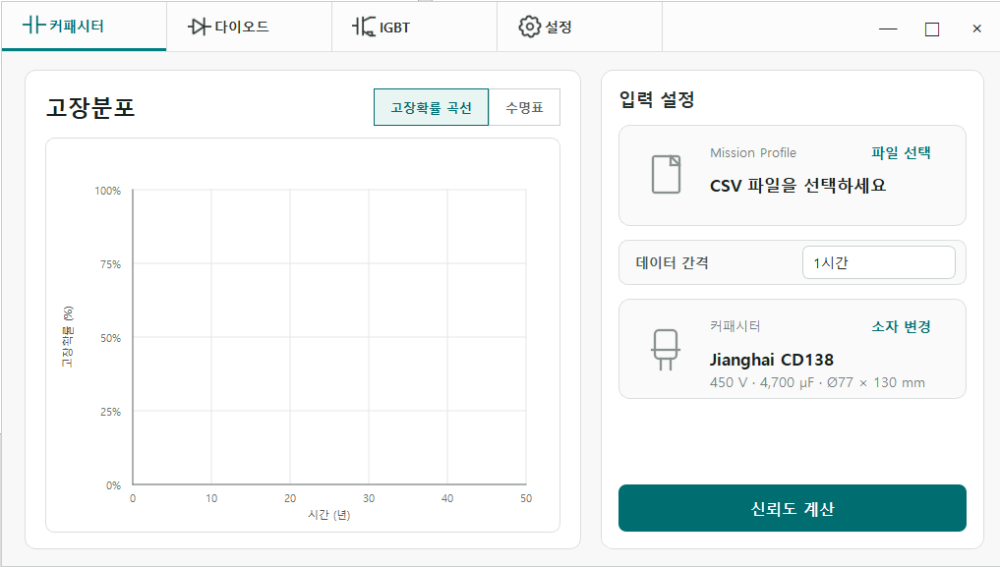
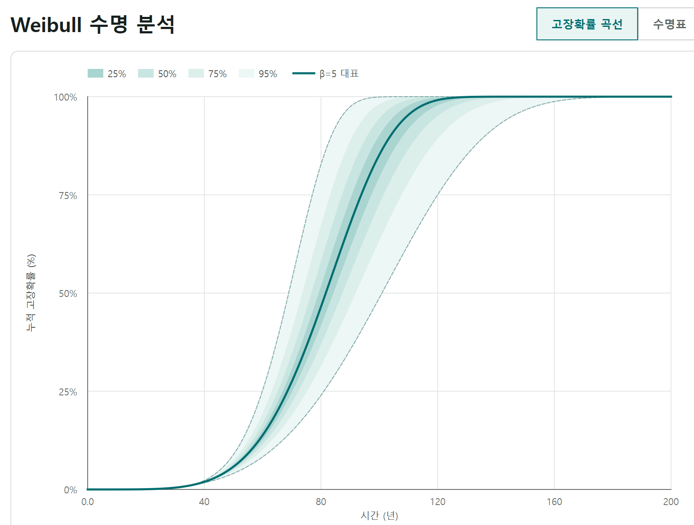

# 전력소자 수명 추정 프로그램

운전 프로파일(Mission Profile)과 부품 파라미터를 바탕으로 **커패시터·IGBT·다이오드의 수명 및 고장확률을 분석하는 Windows 데스크톱 프로그램**입니다.

## 다운로드

**[실행파일 및 예제 데이터 다운로드 → Releases](https://github.com/dohee0129/capacitor-lifetime-estimator/releases/latest)**

| 파일 | 용도 |
| --- | --- |
| `CapacitorLifetimeEstimator.exe` | Windows 실행파일 |
| `mission-profile-examples.zip` | 커패시터·IGBT·다이오드 입력 예제 |
| `SHA256SUMS.txt` | 다운로드 파일의 SHA-256 해시 |

이 저장소는 제공된 프로그램의 **실행파일 배포 및 사용 안내용 저장소**입니다. 원본 Python 소스코드는 제공된 자료에 포함되지 않아 현재 저장소에 없습니다. 실행파일은 Git 이력에 넣지 않고 Release 첨부파일로 제공합니다.

## 주요 기능

- 커패시터, IGBT, 다이오드별 분석 화면
- 부품 데이터베이스를 통한 소자 선택 및 운전 프로파일 CSV 입력
- 커패시터의 전류·전압·주변온도에 따른 발열 및 수명 추정
- IGBT·다이오드의 손실, 온도 변화와 열 사이클 누적손상 분석
- 누적 고장확률 곡선과 고장확률별 수명표 표시
- Weibull 및 Monte Carlo 분석을 이용한 모델 파라미터 불확실성 반영

기능과 계산 흐름은 함께 제공된 「소자 수명 추정 정리」 설명 문서를 기준으로 정리했습니다. 아래 화면도 해당 문서에 포함된 실제 프로그램 화면입니다.

## 프로그램 화면

### 입력 및 소자 선택

### 커패시터 분석 결과 예시

위 결과는 설명 문서의 예시이며, 모든 부품과 운전 조건에 적용되는 보장 수명이 아닙니다.

## 사용 방법

1. [최신 Release](https://github.com/dohee0129/capacitor-lifetime-estimator/releases/latest)에서 실행파일과 예제 ZIP을 다운로드합니다.
2. 예제 ZIP을 압축 해제한 뒤 Windows에서 `CapacitorLifetimeEstimator.exe`를 실행합니다.
3. 분석할 소자 종류를 선택합니다.
4. `소자 변경`에서 분석 대상 부품을 선택하고, 입력 데이터의 시간 간격을 확인합니다.
5. `파일 선택`에서 해당 소자의 CSV 운전 프로파일을 불러옵니다.
6. 분석을 실행하고 고장확률 곡선과 수명표를 확인합니다.

예제 CSV는 [`examples/`](examples/)에서도 개별 다운로드할 수 있습니다. 원본 CSV의 열 이름과 값은 그대로 보존했고 파일명만 영문으로 정리했습니다.

## 입력 데이터

### 커패시터

파일: [`capacitor_mission_profile.csv`](examples/capacitor_mission_profile.csv)

| 열 이름 | 의미 | 단위 |
| --- | --- | --- |
| `duration_h` | 해당 운전 조건의 지속시간 | h |
| `Iripple_rms_A` | 리플전류 실효값 | A |
| `Vdc_V` | 운전 전압 | V |
| `T_ambient_C` | 주변온도 | °C |

### IGBT 및 다이오드

파일: [`igbt_mission_profile.csv`](examples/igbt_mission_profile.csv), [`diode_mission_profile.csv`](examples/diode_mission_profile.csv)

| 열 이름 | 의미 | 단위 |
| --- | --- | --- |
| `Irms [A]` | 전류 실효값 | A |
| `Iavg_abs [A]` | 전류 절댓값 평균 | A |
| `T_heatsink [°C]` | 방열판 온도 | °C |
| `f_sw [Hz]` | 스위칭 주파수 | Hz |
| `V_switch [V]` | 스위칭 소자 양단 전압 | V |

스위칭 소자 예제에는 별도 시간 열이 없으므로 프로그램의 입력 간격을 데이터에 맞게 설정해야 합니다. 제공된 설명 문서에서는 커패시터 1시간, 스위칭 소자 1분의 샘플링 간격을 설명합니다.

## 계산 개요

- **커패시터:** 리플전류·ESR·열 파라미터로 온도를 추정하고 온도 및 전압 가속모델을 적용합니다. 운전 구간별 소모수명을 누적하여 수명 및 Weibull 고장확률을 계산합니다.
- **IGBT·다이오드:** 도통·스위칭 손실로 온도를 계산하고 Rainflow counting으로 열 사이클을 추출합니다. Power Cycling 모델과 누적손상 계산, Monte Carlo 분석으로 수명 분포를 평가합니다.

결과는 입력 데이터, 선택한 부품 파라미터, 샘플링 간격과 모델 가정에 따른 추정값입니다. 정확도에 대한 별도의 실측 검증 결과는 이번 배포 자료에 추가하지 않았습니다.

## 개발환경

배포 실행파일의 패키지 구성을 확인한 항목입니다.

| 구성 | 확인된 기술 |
| --- | --- |
| 언어·런타임 | Python 3.12 |
| 데스크톱 GUI | PySide6 / Qt |
| 열 사이클 분석 | rainflow |
| 부품 데이터베이스 | SQLite |
| 실행파일 패키징 | PyInstaller |
| 실행 대상 | Windows |

## 배포 정보

- 배포 태그 `snapshot-2026-10-28`은 제공받은 실행파일을 구분하기 위한 날짜 태그이며, 개발자가 지정한 프로그램 버전을 의미하지 않습니다.
- 원본 `수명추정_프로그램.exe`는 파일명만 `CapacitorLifetimeEstimator.exe`로 정리했습니다. 실행파일 내용은 재빌드하거나 수정하지 않았습니다.
- 참고문헌 원문 PDF와 제조사 문서 원본은 이 저장소에 재배포하지 않습니다.
- 현재 별도의 오픈소스 라이선스를 부여하지 않았습니다. 사용한 외부 라이브러리의 권리는 각 권리자에게 있습니다.

## 소스코드 공개 상태

| 항목 | 상태 |
| --- | --- |
| 프로그램 실행파일 | Releases에서 제공 |
| 입력 예제 데이터 | 저장소 및 Releases에서 제공 |
| 사용 안내와 화면 예시 | 저장소에서 제공 |
| 원본 Python 소스코드 | 미포함 |

원본 소스코드가 확보되면 개발 환경 설정, 의존성 목록 및 빌드 절차와 함께 추가할 수 있습니다.
